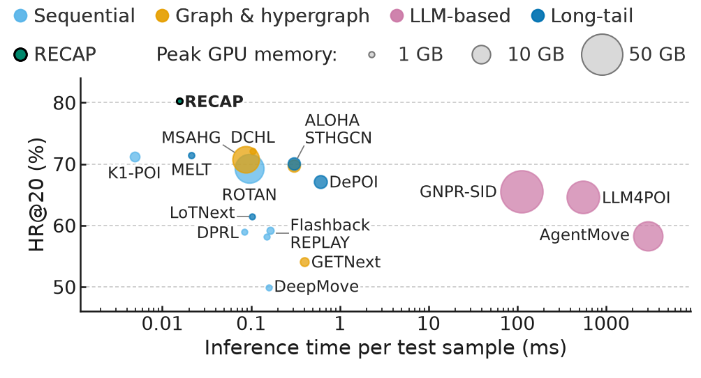
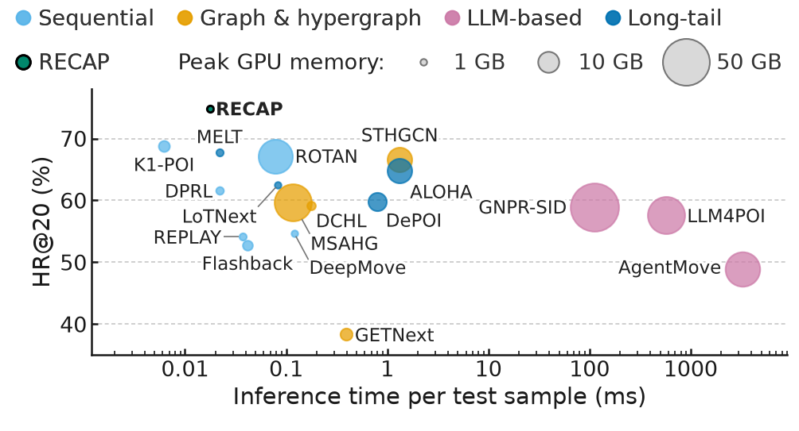
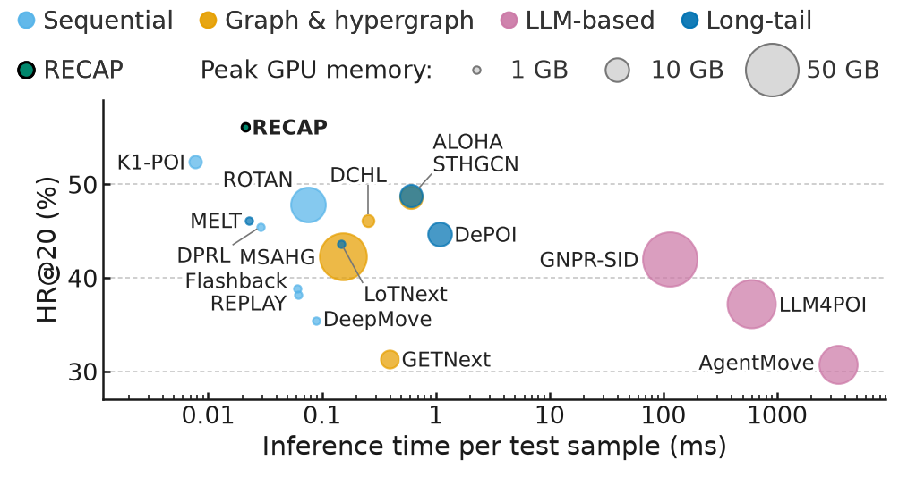
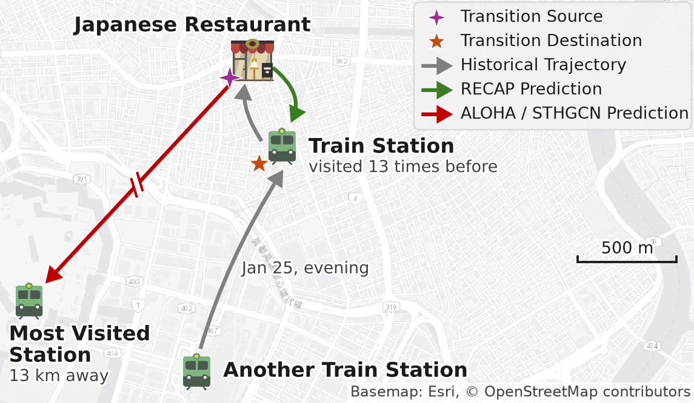

# RECAP

**Beyond Long-Tail POIs: Transition-Centered Modeling for Human Mobility Prediction**

Dingyang Lyu, Zhengjia Xu, Jey Han Lau, Jianzhong Qi

Paper: https://arxiv.org/abs/2605.05771

RECAP (REtrieval Combined with pArametric memory for next-POI prediction) predicts the next POI of a user. A Transformer backbone scores all POIs from the recent check-ins, a graph token adds multi-hop evidence from the global transition graph, and a revisit scorer reads statistics of the user's own history and raises the scores of POIs the user has visited. The backbone is trained first; the revisit scorer is then trained with the backbone frozen.

## Requirements

```bash
pip install -r requirements.txt
```

## Data

The experiments use check-ins from New York (NYC), Tokyo (TKY) and California (CA). There are two ways to get the data.

### Option 1: use the processed data

Download `recap-data.tar.gz` from https://share.iswiftai.com/share/7YojK3RV (anonymous link) and extract it in the root of this repository:

```bash
tar -xzf recap-data.tar.gz
```

This gives `data/NYC/`, `data/TKY/` and `data/CA/`, each with `train.csv`, `val.csv` and `test.csv`. The configs in `configs/` read these directories, so no further step is needed.

### Option 2: process the source data yourself

The scripts in `scripts/` produce the same files from the public source data.

**Sources.**

- **NYC and TKY**: the Foursquare check-ins of New York and Tokyo from 12 April 2012 to 16 February 2013 (227,428 and 573,703 check-ins), released by Dingqi Yang on the page https://sites.google.com/site/yangdingqi/home/foursquare-dataset (section "NYC and Tokyo Check-in Dataset"; the download link on that page is https://drive.google.com/file/d/1VE67jfSN-GV6fkCfuyBEQJzk_qy-SfOk/view). Please cite

  > Dingqi Yang, Daqing Zhang, Vincent W. Zheng and Zhiyong Yu. Modeling User Activity Preference by Leveraging User Spatial Temporal Characteristics in LBSNs. IEEE Transactions on Systems, Man, and Cybernetics: Systems, 45(1):129–142, 2015.

- **CA**: the Gowalla check-ins in California (241,610 check-ins, March 2009 to October 2010), file `dataset/Gowalla-CA.zip` of the GETNext repository, https://github.com/songyangco/GETNext/raw/master/dataset/Gowalla-CA.zip. These files were already filtered by the GETNext authors. Please cite

  > Song Yang, Jiamou Liu and Kaiqi Zhao. GETNext: Trajectory Flow Map Enhanced Transformer for Next POI Recommendation. SIGIR 2022.

**Steps.**

1. Download the two source archives above. From the Foursquare archive, take `dataset_TSMC2014_NYC.txt` and `dataset_TSMC2014_TKY.txt`. From `Gowalla-CA.zip`, take only the three check-in files; the two graph files in the zip (2.4 GB) are not needed:

   ```bash
   unzip -j Gowalla-CA.zip gowalla_train.csv gowalla_val.csv gowalla_test.csv -d raw/gowalla
   ```

2. Place the files as

   ```
   raw/dataset_TSMC2014_NYC.txt
   raw/dataset_TSMC2014_TKY.txt
   raw/gowalla/gowalla_train.csv
   raw/gowalla/gowalla_val.csv
   raw/gowalla/gowalla_test.csv
   ```

   The files we used have these MD5 checksums:

   | File | MD5 |
   |---|---|
   | `dataset_TSMC2014_NYC.txt` | `68b4d55f38c0b400a360dba71dee2edf` |
   | `dataset_TSMC2014_TKY.txt` | `75d0903093c92615e2602347c551fd1d` |
   | `gowalla_train.csv` | `c2a1b0cd6587cd9ccf4a13c57a71712c` |
   | `gowalla_val.csv` | `1cedc70fdde3c86dc7697a4078cd6538` |
   | `gowalla_test.csv` | `a8b41fc4ac9b2fdf316a9220fda43b43` |

3. Run, from the root of the code repository,

   ```bash
   python scripts/preprocess.py --dataset NYC --input raw/dataset_TSMC2014_NYC.txt --min-poi-checkins 10
   python scripts/preprocess.py --dataset TKY --input raw/dataset_TSMC2014_TKY.txt --min-poi-checkins 10
   python scripts/prepare_ca.py --input-dir raw/gowalla --output-dir raw/CA
   python scripts/preprocess.py --dataset CA --input raw/CA
   ```

   Each `preprocess.py` command writes `data/<city>/{train,val,test}.csv` and overwrites existing files. With Python 3.12 and pandas 2.3.3 (the version in `requirements.txt`), the commands reproduce the nine files of the processed data byte for byte.

**What the scripts do.**

1. **CA only**: `scripts/prepare_ca.py` merges the three Gowalla files, ignores their trajectory IDs and their train, validation and test assignment, and converts them into the column format of the other two cities. Local time, time zone offset and day of week are computed in the `America/Los_Angeles` time zone, with daylight saving time.
2. **NYC and TKY only**: check-ins at POIs with fewer than 10 check-ins are removed. CA is not filtered further.
3. The check-ins of each user are ordered by local time. A new trajectory starts whenever two consecutive check-ins of the same user are more than 48 hours apart.
4. Trajectories with only one check-in are removed.
5. All check-ins are ordered by local time. The first 80% form the training split, the next 10% the validation split and the last 10% the test split. The cut is made over all users at once, not per user.
6. Check-ins in the validation and test splits whose user or POI does not appear in the training split are removed. Only these rows are removed; trajectory IDs are not changed and the training split is not changed. As a result, every user and every POI in the validation and test splits also appears in the training split.

### Statistics

| City | Check-ins | Users | POIs | Trajectories | Train rows | Validation rows | Test rows |
|---|---:|---:|---:|---:|---:|---:|---:|
| NYC | 134,481 | 1,074 | 5,069 | 18,010 | 108,891 | 12,954 | 12,636 |
| TKY | 424,585 | 2,281 | 7,836 | 48,845 | 341,175 | 42,077 | 41,333 |
| CA | 221,359 | 3,652 | 9,756 | 19,930 | 193,252 | 16,305 | 11,802 |

Users, POIs and trajectories are counted over the three splits together.

### Columns

Each row is one check-in. Within each file the rows are ordered by local time.

| Column | Content |
|---|---|
| `user_id` | user ID from the source file |
| `POI_id` | POI ID from the source file |
| `POI_catid` | category ID from the source file. For CA this is the integer category ID written as text |
| `POI_catid_code` | integer category ID. For NYC and TKY, categories are numbered in sorted order of `POI_catid` over all check-ins of the source file, before any filtering, so the codes in the processed files are not contiguous. For CA this is the category ID of the source file |
| `POI_catname` | category name from the source file |
| `latitude`, `longitude` | coordinates of the POI |
| `timezone` | offset of local time from UTC, in minutes |
| `UTC_time` | check-in time in UTC, e.g. `2012-04-03 18:00:09+00:00` |
| `local_time` | check-in time in local time. It is written with a `+00:00` suffix, but the clock time is local, e.g. `2012-04-03 14:00:09+00:00` for the row above |
| `day_of_week` | day of week of the local time, 0 is Monday |
| `norm_in_day_time` | seconds since local midnight divided by 86,400 |
| `trajectory_id` | `<user_id>_<k>`, where `k` counts the trajectories of the user from 1 in step 3. Numbers of trajectories removed in step 4 are skipped |

## Training

```bash
python train_backbone.py --config configs/nyc.yaml --seed 3407 --run runs/nyc-3407
python train_scorer.py --config configs/nyc.yaml --seed 3407 --run runs/nyc-3407
```

## Results

`results/` holds the per-seed results of the tables and figures in the paper; see `results/README.md`.

## Efficiency

Each figure plots HR@20 against the average inference time per test sample (log scale). The area of each point shows the peak GPU memory of the method.

NYC



TKY



CA



## Case Study

This is the case study figure in the paper: a prediction example for an unseen transition on TKY.



Basemap: Esri, © OpenStreetMap contributors.

## Citation

```bibtex
@article{lyu2026recap,
  title   = {Beyond Long-Tail POIs: Transition-Centered Modeling for Human Mobility Prediction},
  author  = {Lyu, Dingyang and Xu, Zhengjia and Lau, Jey Han and Qi, Jianzhong},
  journal = {arXiv preprint arXiv:2605.05771},
  year    = {2026}
}
```
